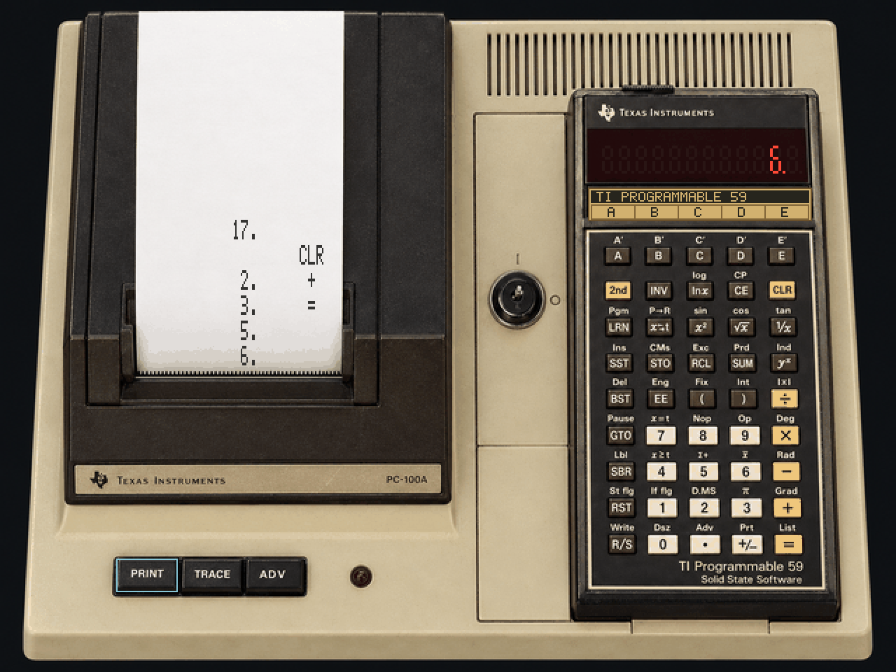

# TI-59 for MiSTer

A TI-59 programmable calculator running its original firmware, with a
photographic panel, magnetic cards, a thermal printer and mechanical sound
effects.

## Install

1. Download [TI59_20261028.rbf](releases/TI59_20261028.rbf).
2. Copy it to `_Computer/` on your MiSTer SD card and launch it.
3. Optionally copy the files in [examples/cards](examples/cards) to `games/TI59/`.

The firmware and Master Library are built in. No separate boot ROM is needed.

## Get started

Use **arrow keys** or the **gamepad D-pad** to highlight a button, then press
**Space** or the gamepad's **Press key** button. This works for every calculator
key and the three printer buttons. Mouse input is not supported.

You can also type calculations directly: try **2 + 3 Enter** to get `5.`.

| Keyboard | Action |
| --- | --- |
| Numbers, `+`, `-`, `*`, `/`, `.` | Enter a calculation |
| Enter or `=` | Equals |
| Backspace or Escape | Clear |
| Tab or Y | 2nd function |
| F12 | Open the MiSTer menu |

For functions printed above a key, press **2nd**, then that key.
See [all keyboard shortcuts and programming examples](docs/usage.md#controls).

## Cards and printing

To try a magnetic card, open **F12 → Load magnetic card** and choose
`multiply.crd`. Wait for it to finish loading, then press **T**, **R**
(RST, R/S). The program calculates `2 × 3` and displays `6.`.
`two-pass.crd` runs the same program with two animated card passes.

Load cards while the calculator is stopped and outside Learn mode. Loading
clears the current calculation and replaces the program or data banks on the
card. A red card means the load failed. See [card formats and conversion](docs/usage.md#magnetic-cards).

| Keyboard | Printer action |
| --- | --- |
| F6 — PRINT | Print the displayed value |
| F7 — ADV | Feed paper; hold to keep feeding |
| F8 — TRACE | Toggle automatic printing of calculations |

When Trace is on, wait for each line to finish before the next operation.
**Clear printer paper** in the MiSTer menu clears the page without clearing
calculator memory.

## Display and sound

In the MiSTer menu, **GUI resolution** selects **240p** or **480p** for Direct
Video and native analog output.

**Sound effects** offers **Normal**, **Quiet**, and **Off** for key taps,
the card motor and the printer.

## Things to know

- Calculator memory is lost on power cycling or leaving the core.
- Card writing, memory saves and printer-output export are not implemented.
- The Master Library is included. [Using other library modules](docs/usage.md#library-modules)
  requires a complete 5,000-byte ROM file and resets the calculator.

[User guide](docs/usage.md) · [Building and testing](docs/development.md) ·
[Validation](docs/validation.md) · [Research and credits](docs/research.md) ·
[Artwork](assets/README.md)

Core HDL and local tools are [GPL-2.0-or-later](LICENSE). TI firmware has separate
[copyright and provenance](roms/provenance.json); shared framework files retain
their original notices.
